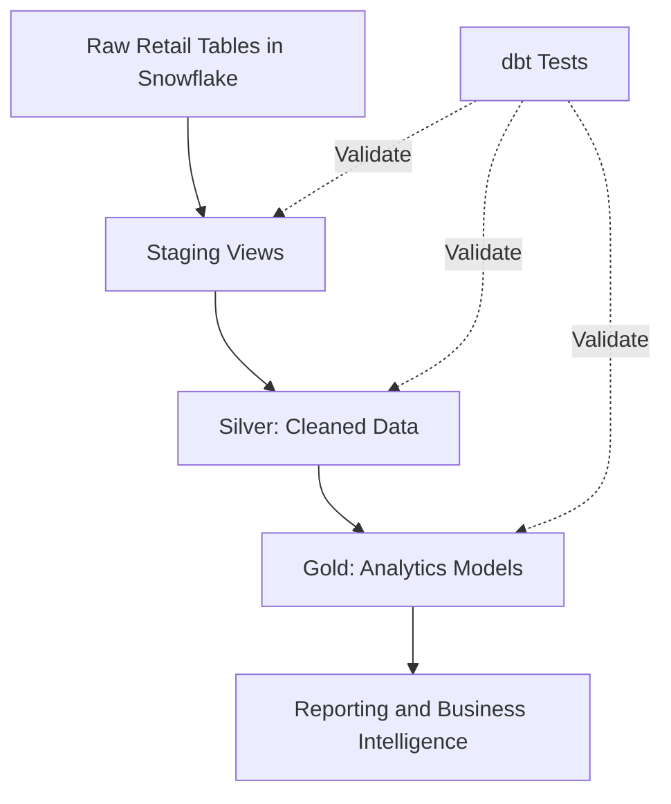

# Retail Data Engineering Pipeline with dbt Core & Snowflake

A portfolio project demonstrating a retail ELT pipeline using **dbt Core, Snowflake SQL, and the Medallion Architecture**. The project transforms raw retail data into analytics-ready models and includes reusable macros, incremental processing, snapshots, and automated data quality tests.

> **Project status:** Core dbt pipeline successfully built and tested using synthetic retail sample data. This is an educational portfolio project, not a production deployment.

## Project Overview

Retail analytics teams need reliable, consistent data to understand sales trends, customer behavior, and product performance. This project demonstrates how raw customer, product, and transaction tables can be transformed into structured datasets for downstream reporting.

The pipeline follows a Bronze → Staging → Silver → Gold workflow, with dbt managing SQL transformations, dependencies, and data quality tests.

### Key Features

- Medallion-style data architecture
- Snowflake as the cloud data warehouse
- Modular SQL models managed with dbt Core
- Reusable Jinja macros
- Incremental model with merge strategy
- dbt snapshot for historical tracking
- Automated data quality tests
- dbt-utils package
- Git-based version control

## Architecture



## Technology Stack

| Category | Technology |
|---|---|
| Data warehouse | Snowflake |
| Transformation | dbt Core |
| SQL dialect | Snowflake SQL |
| Templating | Jinja |
| Data modeling | Bronze → Silver → Gold |
| Data quality | dbt tests |
| Historical tracking | dbt snapshots |
| Incremental processing | dbt incremental models |
| Reusable utilities | dbt-utils |
| SQL linting | SQLFluff configuration included |
| Version control | Git and GitHub |

## Project Structure

```text
retail-data-engineering-dbt-snowflake/
├── analyses/
├── assets/
│   └── screenshots/
├── macros/
│   └── calculate_revenue.sql
├── models/
│   ├── staging/
│   ├── silver/
│   ├── gold/
│   ├── schema.yml
│   ├── sources.yml
│   └── exposures.yml
├── seeds/
├── snapshots/
├── tests/
├── dbt_project.yml
├── packages.yml
├── requirements.txt
├── selectors.yml
├── .sqlfluff
├── .gitignore
└── README.md
```

Generated folders such as `target/`, `logs/`, `dbt_packages/`, and the local virtual environment may be created while working with the project.

## Data Architecture

### 1. Bronze — Raw Data

The Bronze layer contains the source tables in Snowflake's `BRONZE` schema.

| Source table | Description |
|---|---|
| `RAW_CUSTOMER` | Customer attributes and purchase counts |
| `RAW_PRODUCT` | Product details, prices, inventory, and ratings |
| `RAW_ORDERS` | Transactions, quantities, amounts, and transaction dates |

The current development environment uses **synthetic sample data** created for testing. The project does not currently provide an automated ingestion pipeline that loads external retail CSV files into Bronze.

### 2. Staging — Source Preparation

Staging models provide a consistent interface to the raw tables.

- `stg_customer`
- `stg_product`
- `stg_orders`

These models are implemented as Snowflake views.

### 3. Silver — Cleaned Data

The Silver layer contains three models:

| Model | Purpose |
|---|---|
| `customer` | Standardizes customer attributes and applies basic validation |
| `product` | Standardizes product categories and price types |
| `orders` | Prepares transaction records for analytics |

These models provide reusable, cleaned inputs for downstream business transformations.

### 4. Gold — Analytics

The Gold layer contains nine analytical models.

| Model | Business purpose |
|---|---|
| `daily_sales` | Daily sales metrics |
| `monthly_sales` | Monthly sales trends |
| `category_sales` | Sales by product category |
| `customer_summary` | Customer purchasing summaries |
| `customer_segmentation` | Customer value segments |
| `product_performance` | Product-level sales metrics |
| `top_customers` | Ranking customers by value |
| `executive_dashboard` | Consolidated business KPIs |
| `incremental_sales` | Incrementally maintained transaction analytics |

These models are designed to support reporting and downstream business intelligence.

## Incremental Processing

The `incremental_sales` model demonstrates incremental processing using dbt's incremental materialization.

| Setting | Value |
|---|---|
| Materialization | Incremental |
| Strategy | Merge |
| Unique key | `transaction_id` |

The model uses transaction dates to identify records newer than the latest date already processed. This demonstrates a basic incremental pattern.

**Limitation:** A date-based filter can miss late-arriving or corrected records with older transaction dates. Production implementations should account for late-arriving data, updates, and backfills.

## Snapshot Management

The project includes a dbt snapshot for historical tracking.

Snapshots can preserve changes to source records over time and support slowly changing dimension (SCD Type 2) analysis, depending on the configured snapshot strategy.

The snapshot has been executed successfully in the development environment.

## Data Quality Testing

The project defines dbt tests for key data integrity rules, including:

- Unique identifiers
- Non-null required fields
- Relationships between orders, customers, and products

The configured data tests have been executed successfully against the synthetic development dataset.

## Reusable Macros and Packages

### `calculate_revenue`

A custom Jinja macro used by analytical models to centralize reusable revenue-related SQL logic.

### `dbt-utils`

The project includes the `dbt-utils` package, which provides reusable utilities for dbt projects.

## Validation Results

The following results were observed during development against the configured Snowflake environment and synthetic sample data.

| Validation | Result |
|---|---|
| `dbt parse` | Successful |
| `dbt debug` | Successful connection and configuration checks |
| Staging models | 3 successful |
| Silver models | 3 successful |
| Gold models | 9 successful |
| Configured data tests | 13 passed |
| Seed execution | 1 successful |
| Snapshot execution | 1 successful |
| Full `dbt build` | 30 passed, 0 warnings, 0 errors, 1 no-op |

These are development validation results, not performance benchmarks or evidence of production deployment. The SQLFluff configuration is included, but a complete successful lint run has not yet been verified.

## Setup and Execution

### Prerequisites

- Python and pip
- Git
- A Snowflake account with permission to create and query the required database objects
- dbt Core with the Snowflake adapter

### 1. Clone the repository

```bash
git clone https://github.com/nachiii-1705/retail-data-engineering-dbt-snowflake.git
cd retail-data-engineering-dbt-snowflake
```

### 2. Create and activate a virtual environment

On Windows PowerShell:

```powershell
python -m venv .venv
.\.venv\Scripts\Activate.ps1
```

### 3. Install dependencies

```powershell
python -m pip install -r requirements.txt
```

### 4. Configure Snowflake

Configure the `retail_etl` profile in your local `profiles.yml` file, normally located at:

```text
%USERPROFILE%\.dbt\profiles.yml
```

Use the profile name specified in `dbt_project.yml`. Configure the Snowflake account, user, authentication method, warehouse, database, schema, and role for your own environment.

**Never commit passwords, private keys, access tokens, or other credentials to GitHub.**

### 5. Prepare the source data

Create and populate the required source tables in the `BRONZE` schema of your configured Snowflake database. The development results documented here used synthetic sample records.

The source tables must exist before the staging models can run. The current repository does not automatically ingest the sample records into Snowflake.

### 6. Install dbt packages and validate the connection

```powershell
dbt deps
dbt debug
dbt parse
```

### 7. Run the pipeline

Run the layers individually:

```powershell
dbt run --select path:models/staging
dbt run --select path:models/silver
dbt run --select path:models/gold
```

Or execute the configured models, tests, seeds, and snapshots together:

```powershell
dbt build
```

To run the configured data quality tests separately:

```powershell
dbt test
```

## Known Limitations

- The development dataset is synthetic and small.
- Raw data ingestion is not automated.
- Source freshness monitoring is not configured because the source tables lack a reliable ingestion timestamp. `transaction_date` represents when an order occurred, not when the record was loaded.
- The incremental model's date-based filter may miss late-arriving records.
- SQLFluff linting has not yet been fully validated.
- The pipeline has been validated in a development Snowflake environment, not a production deployment.

## Future Improvements

- Add reproducible scripts for creating and loading Bronze tables.
- Introduce an ingestion timestamp and configure meaningful source freshness checks.
- Improve incremental processing to handle late-arriving and corrected records.
- Add more business-rule and edge-case tests.
- Verify SQLFluff linting and formatting across all project models.
- Add continuous integration with GitHub Actions.
- Generate and publish dbt documentation and model lineage.
- Add a business intelligence dashboard using validated Gold outputs.
- Document least-privilege Snowflake roles and deployment practices.

## Skills Demonstrated

- SQL and Snowflake
- dbt Core and Jinja
- ELT pipeline design
- Dimensional and analytical data modeling
- Medallion architecture
- Incremental transformations
- Historical data tracking
- Data quality testing
- Git and GitHub
- Analytics engineering

## License and Attribution

Refer to the repository's `LICENSE` file for the applicable license and reuse terms. This repository is a portfolio adaptation of an existing project; retain the original author's attribution and applicable license notices when making modifications.
