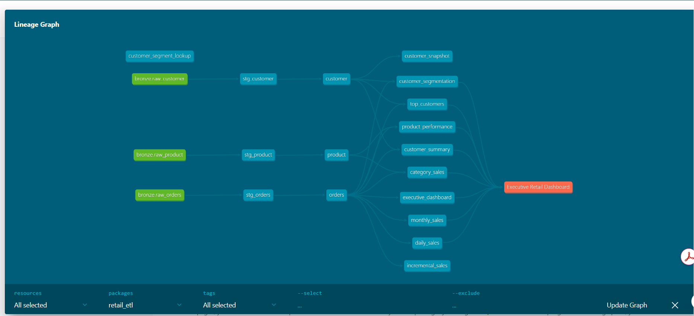
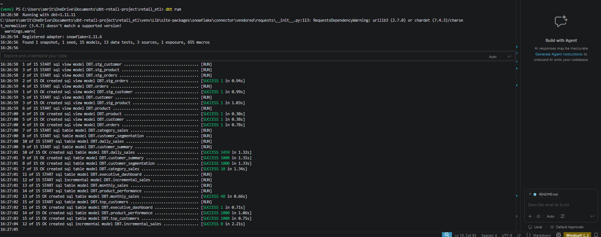
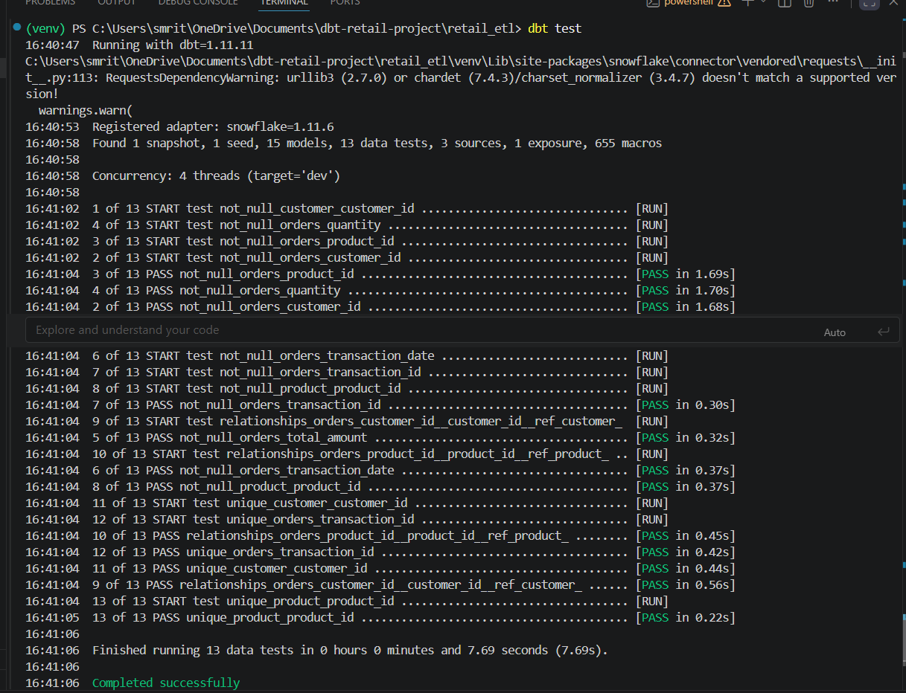
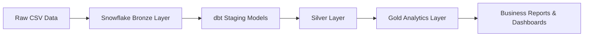

# 🚀 Retail Data Engineering Pipeline using dbt & Snowflake

> Production-style Analytics Engineering project implementing the Medallion Architecture (Bronze → Silver → Gold) using dbt Core, Snowflake, SQLFluff, snapshots, incremental models, reusable macros, and automated data quality testing.


---


</div>

---

## 📌 Project Overview

This project demonstrates the design and implementation of a modern analytics engineering workflow using **dbt Core** and **Snowflake**. It transforms raw retail transaction data into clean, analytics-ready datasets through a modular ELT pipeline.

The project follows software engineering best practices including reusable SQL, automated data quality testing, incremental processing, snapshot-based history tracking, SQL linting, and version-controlled transformations.

The primary objective is to showcase production-oriented data engineering practices rather than simply building reporting tables.

---
## 📸 Project Preview
### 📈 dbt Model Lineage

This lineage graph illustrates how raw retail data flows through the Medallion Architecture—from Bronze sources to Silver transformations and Gold business-ready models—using dbt's dependency graph.



---

### ✅ Successful dbt Run



### ✅ Data Quality Tests



# 📚 Table of Contents

- [Project Architecture](#-project-architecture)
- [Technology Stack](#-technology-stack)
- [Project Structure](#-project-structure)
- [Data Pipeline](#-data-pipeline)
- [Bronze Layer](#-bronze-layer)
- [Staging Layer](#-staging-layer)
- [Silver Layer](#-silver-layer)
- [Gold Layer](#-gold-layer)
- [Incremental Processing](#-incremental-processing)
- [Snapshots](#-snapshots)
- [Data Quality Testing](#-data-quality-testing)
- [SQLFluff Integration](#-sqlfluff-integration)
- [Packages Used](#-packages-used)
- [How to Run](#-how-to-run)
- [Project Metrics](#-project-metrics)
- [Known Limitations](#-known-limitations)
- [Future Enhancements](#-future-enhancements)
---

# 🏗️ Project Architecture


---

# 💻 Technology Stack

| Category | Technology |
|----------|------------|
| Data Warehouse | Snowflake |
| Transformation | dbt Core |
| SQL Dialect | Snowflake SQL |
| Programming | Python 3.13 |
| Data Modeling | Bronze → Silver → Gold |
| Version Control | Git & GitHub |
| Data Quality | dbt Tests |
| Historical Tracking | dbt Snapshots |
| Incremental Processing | dbt Incremental Models |
| Reusable Logic | Jinja Macros |
| Package | dbt-utils |
| SQL Style Enforcement | SQLFluff |
---

# 📁 Project Structure

```text
retail_etl/
│
├── analyses/
├── dbt_packages/
├── logs/
├── macros/
│   └── calculate_revenue.sql
│
├── models/
│   ├── staging/
│   ├── silver/
│   ├── gold/
│   └── sources.yml
│
├── seeds/
├── snapshots/
├── target/
├── tests/
│
├── dbt_project.yml
├── packages.yml
├── selectors.yml
├── requirements.txt
├── .sqlfluff
└── README.md
```
---

# 🔄 Data Pipeline

The project follows the Medallion (Bronze → Silver → Gold) architecture to progressively improve data quality and prepare datasets for analytics.

```text
Raw CSV Files
      │
      ▼
Snowflake Bronze Tables
      │
      ▼
dbt Staging Models
      │
      ▼
Silver Business Models
      │
      ▼
Gold Analytics Models
      │
      ▼
Business Intelligence / Dashboards
```

Each layer has a single responsibility, making the pipeline modular, maintainable, and scalable.
---

# 🥉 Bronze Layer

### Purpose

The Bronze layer stores raw retail data exactly as received from the source system with minimal transformation.

### Source Tables

| Table | Description |
|--------|-------------|
| RAW_CUSTOMER | Customer master data |
| RAW_PRODUCT | Product catalog |
| RAW_ORDERS | Retail transaction data |

### Design Principles

- Preserve raw source data
- No business logic applied
- Acts as the system of record
- Supports reproducibility and auditing
---

# 🏗️ Staging Layer

The staging layer standardizes raw source data before business transformations.

### Responsibilities

- Rename columns
- Apply consistent naming conventions
- Standardize data types
- Prepare clean inputs for downstream models

### Models

- stg_customer
- stg_product
- stg_orders
---

# 🥈 Silver Layer

The Silver layer contains cleaned and business-ready datasets.

### Models

- customer
- product
- orders

### Responsibilities

- Data cleansing
- Business rule implementation
- Standardized dimensions
- Reusable analytical datasets
---

# 🥇 Gold Layer

The Gold layer provides analytics-ready models optimized for reporting and business intelligence.

### Analytical Models

| Model | Purpose |
|--------|----------|
| daily_sales | Daily sales reporting |
| monthly_sales | Monthly business trends |
| category_sales | Category-level revenue analysis |
| customer_summary | Customer purchasing behavior |
| customer_segmentation | Customer segmentation |
| product_performance | Product performance metrics |
| top_customers | High-value customer analysis |
| executive_dashboard | Executive KPI reporting |
| incremental_sales | Incremental transaction processing |

These models are designed to serve dashboards, reporting tools, and business stakeholders.
---

# ⚡ Incremental Processing

To improve performance and reduce processing time, the project includes an **incremental dbt model**.

### Objective

Instead of rebuilding the entire transaction table on every execution, only newly arrived records are processed.

### Configuration

- Materialization: `incremental`
- Strategy: `merge`
- Unique Key: `transaction_id`

### Benefits

- Faster execution
- Reduced warehouse compute cost
- Production-friendly design
- Scalable for large datasets
---

# 📸 Snapshot Management

The project uses **dbt Snapshots** to preserve historical changes in customer data.

### Snapshot Strategy

- Timestamp-based tracking
- Historical record preservation
- Slowly Changing Dimension (SCD Type 2) approach

### Benefits

- Historical reporting
- Audit capability
- Customer history analysis
---

# ✅ Data Quality Testing

Data quality is validated using built-in dbt tests.

### Tests Implemented

- Not Null
- Unique
- Relationships
- Accepted Values

### Purpose

These automated tests ensure that transformed datasets remain reliable and analytics-ready.
---

# 🎨 SQL Style Enforcement

The project integrates **SQLFluff** to maintain consistent SQL formatting and enforce coding standards.

### Features

- Snowflake SQL dialect
- dbt templater
- Consistent formatting
- Readable SQL
- Automated linting

### Outcome

All project models successfully pass SQLFluff linting, ensuring a clean and maintainable SQL codebase.
---

# 📦 dbt-utils Package

The project uses the **dbt-utils** package to extend dbt functionality with reusable macros and utilities.

### Benefits

- Reusable SQL logic
- Improved maintainability
- Community-supported best practices
---

# 🧩 Reusable Macros

Custom Jinja macros are used to eliminate repetitive SQL logic.

### Macro Included

| Macro | Purpose |
|--------|----------|
| calculate_revenue | Calculates total revenue from quantity × price |

Using macros improves consistency and simplifies maintenance across multiple models.
---

# 🎯 dbt Selectors

Selectors are configured to simplify execution of specific groups of models.

Examples include:

- Gold models
- Silver models
- Staging models

This improves developer productivity by allowing targeted pipeline execution.
---

# 🎯 dbt Selectors

Selectors are configured to simplify execution of specific groups of models.

Examples include:

- Gold models
- Silver models
- Staging models

This improves developer productivity by allowing targeted pipeline execution.
---

# ▶️ Running the Project

Clone the repository:

```bash
git clone https://github.com/yourusername/dbt-retail-project.git
```

Navigate into the project:

```bash
cd retail_etl
```

Create a virtual environment:

```bash
python -m venv venv
```

Activate the environment (Windows):

```powershell
venv\Scripts\activate
```

Install dependencies:

```bash
pip install -r requirements.txt
```

Install dbt packages:

```bash
dbt deps
```

Verify the project:

```bash
dbt debug
```

Run models:

```bash
dbt run
```

Execute tests:

```bash
dbt test
```

Generate documentation:

```bash
dbt docs generate
```

Launch documentation:

```bash
dbt docs serve
```
---

# ⭐ Repository Highlights

- Modular Medallion Architecture
- Snowflake Data Warehouse
- Incremental Processing
- Snapshot Management
- Automated Data Quality Testing
- SQLFluff Integration
- Reusable Jinja Macros
- dbt-utils Package
- Production-style Project Structure
- Version Controlled with Git
---

# ⚠️ Known Limitation

The sample retail dataset does **not** include a dedicated ingestion timestamp (for example, `loaded_at` or `ingestion_timestamp`).

Because dbt source freshness is designed to evaluate data recency using a reliable ingestion timestamp, a meaningful freshness check cannot be demonstrated with this dataset.

Source freshness has been configured as part of the project, but the limitation originates from the sample dataset rather than the dbt implementation.

In a production environment, the source tables would typically include an ingestion timestamp populated by the data ingestion process, enabling accurate freshness monitoring.
---

# 🚀 Future Improvements

Possible future enhancements include:

- CI/CD pipeline using GitHub Actions
- Automated dbt Cloud deployment
- Great Expectations integration
- Airflow orchestration
- Data observability
- Unit testing
- Semantic Layer
- Power BI dashboard integration
---

# 💼 Skills Demonstrated

- Data Engineering
- dbt Core
- Snowflake
- SQL
- Python
- Incremental Models
- Data Warehousing
- Data Modeling
- Medallion Architecture
- Snapshot Management
- Data Quality Testing
- SQL Optimization
- Git
- GitHub
- Analytics Engineering
---

# 📄 License

This project is provided for educational and portfolio purposes.